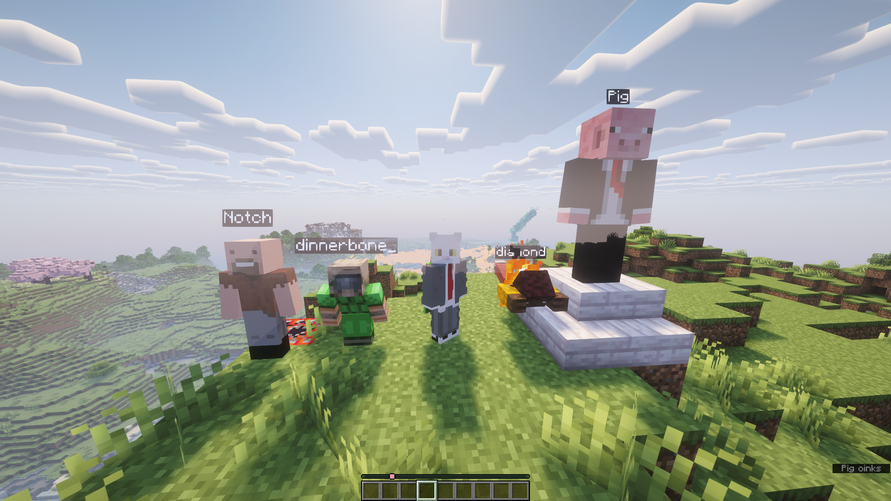
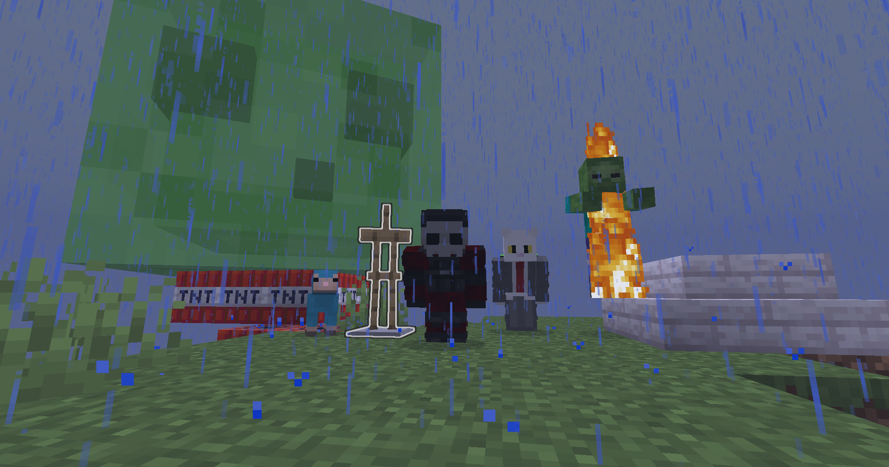

# FlipsDisguises

A [Paper](https://papermc.io/) plugin (Java 21) that disguises players, and other living
entities, as another player or as a mob. It has in-game commands for server owners and a small API for other plugins.



## Contents

- [For server owners](#for-server-owners): [Install](#install) · [Commands](#commands) · [Flags](#flags) · [Permissions](#permissions) · [Configuration](#configuration-configyml)
- [For developers](#for-developers): [Dependency](#add-the-dependency) · [Using the API](#use-the-api) · [Compatibility](#compatibility)
- [Building from source](#building-from-source)

---

## For server owners

### Install

1. Use a Paper server running Java 21. Pick the plugin build that matches your Minecraft version.
2. Drop `flips-disguises-<version>.jar` into `plugins/` and restart.

### Commands

| Command                                              | What it does                                       |
|------------------------------------------------------|----------------------------------------------------|
| `/disguise player <name> [--flags]`                  | Disguise **yourself** as the player `<name>`       |
| `/disguise player <target> <name> [--flags]`         | Disguise another online player                     |
| `/disguise mob <target> <mobType> [--flags]`         | Disguise a player as a mob                         |
| `/disguise entity <entities> <mobType> [--flags]`    | Disguise entities (selector) as a mob              |
| `/disguise entityplayer <entities> <skin> [--flags]` | Show entities (selector) as a player model         |
| `/undisguise [target]`                               | Remove a player's disguise (yourself if no target) |
| `/undisguise entity <entities>`                      | Remove disguises from entities                     |
| `/flipsdisguises reload` (alias `/fd reload`)        | Reload `config.yml`                                |

`<name>` and `<skin>` are looked up by account name.


### Flags

Flags are optional and go at the end: `--flag value`.

```
/disguise mob Steve slime --size 4 --name "<rainbow>Blobby</rainbow>"
/disguise mob Steve wolf --wolfVariant ashen --glowing true
/disguise player Steve Notch --size 2.0 --hat false
/disguise entityplayer @e[type=villager,limit=1] Notch --nametagVisible false
```



**Player-model flags** (`player` and `entityplayer`):
`displayName`, `nametagVisible`, `glowing`, `silent`, `sneaking`, `pose`, `burning`, `leftHanded`, `size`
(0.0625 to 16), and skin layers `cape`, `jacket`, `leftSleeve`, `rightSleeve`, `leftPants`, `rightPants`, `hat`.

**Mob flags** (`mob` and `entity`). Only flags that fit the chosen mob are offered:

| Flag                                                                                     | Applies to                                        |
|------------------------------------------------------------------------------------------|---------------------------------------------------|
| `glowing`, `selfDecoy`, `pose`, `silent`, `sneaking`, `burning`                          | all living mobs                                   |
| `displayName`                                                                            | all mobs                                          |
| `baby`                                                                                   | ageable mobs                                      |
| `size` (1 to 127)                                                                        | slime, magma cube, phantom                        |
| `color`                                                                                  | colorable mobs (sheep, wolf collars, and so on)   |
| `sheared`                                                                                | sheep                                             |
| `charged`                                                                                | creeper                                           |
| `saddled`                                                                                | horse, skeleton horse, zombie horse, donkey, mule |
| `horseColor`, `horseStyle`                                                               | horse                                             |
| `profession`, `villagerType`                                                             | villager, zombie villager                         |
| `axolotlVariant`                                                                         | axolotl                                           |
| `cowVariant`, `catVariant`, `frogVariant`, `pigVariant`, `chickenVariant`, `wolfVariant` | the matching mob                                  |

`displayName` takes a [MiniMessage](https://docs.advntr.dev/minimessage/format.html) / chat component. `selfDecoy false`
turns off the client-side mob you see in third person when you disguise yourself. You then stay invisible to yourself.

Not every mob can be used. Players, display / interaction / marker entities, and non-living entities such as boats,
minecarts and arrows are rejected.

### Permissions

| Permission                       | Allows                                                 |
|----------------------------------|--------------------------------------------------------|
| `flipsdisguises.disguise`        | Base `/disguise` command (needed for every subcommand) |
| `flipsdisguises.disguise.player` | `/disguise player`                                     |
| `flipsdisguises.disguise.mob`    | `/disguise mob`                                        |
| `flipsdisguises.disguise.entity` | `/disguise entity` and `/disguise entityplayer`        |
| `flipsdisguises.undisguise`      | `/undisguise`                                          |
| `flipsdisguises.admin`           | `/flipsdisguises reload`                               |

---

## For developers

Other plugins can use FlipsDisguises through a small API registered with Bukkit's `ServicesManager`. All the API
types are in `ch.eneas.flipsdisguises.api` and the option classes in `ch.eneas.flipsdisguises.disguise`.

### Add the dependency

FlipsDisguises is available through [JitPack](https://jitpack.io/#eneasinfanger/FlipsDisguises). Add the repository
and depend on it as `provided`, since the server already has the plugin:

```xml
<repositories>
    <repository>
        <id>jitpack.io</id>
        <url>https://jitpack.io</url>
    </repository>
</repositories>

<dependencies>
    <dependency>
        <groupId>com.github.eneasinfanger</groupId>
        <artifactId>FlipsDisguises</artifactId>
        <version>${FlipsDisguises.version}</version>
        <scope>provided</scope>
    </dependency>
</dependencies>
```

Gradle:

```kotlin
repositories { maven("https://jitpack.io") }
dependencies { compileOnly("com.github.eneasinfanger:FlipsDisguises:${flipsDisguisesVersion}") }
```

Always use the version with the [latest release tag](https://github.com/eneasinfanger/FlipsDisguises/releases).

Make sure it loads before your plugin, in your `plugin.yml`:

```yaml
depend: [FlipsDisguises]       # required
# softdepend: [FlipsDisguises] # optional integration; check FlipsDisguises.isAvailable() first
```

### Use the API

```java
import ch.eneas.flipsdisguises.api.FlipsDisguises;
import ch.eneas.flipsdisguises.api.FlipsDisguisesApi;

// Optionally check FlipsDisguises.isAvailable()
FlipsDisguisesApi api = FlipsDisguises.api();
```

```java
// Player skin
api.disguiseAsPlayer(player, "Notch").thenAccept(result -> {
    if (result instanceof DisguiseResult.Failure f) {
        player.sendMessage(f.message());
    }
});

// Player model on a player or any other living entity
PlayerDisguiseOptions playerOpts = PlayerDisguiseOptions.DEFAULT.withSize(2.0).withGlowing(true);
api.disguiseAsPlayer(villager, "Notch", playerOpts);

// Mob
api.disguiseAsMob(player, EntityType.CREEPER);
api.disguiseAsMob(player, EntityType.SLIME, MobDisguiseOptions.DEFAULT.withSize(5).withGlowing(true));

// Query and remove
boolean disguised = api.isDisguised(player);
Optional<DisguiseInfo> info = api.getDisguise(player);
api.undisguise(player);
```

Notes:

- Methods that change a disguise throw `IllegalStateException` if not called from main server thread.
  (Queries are fine anywhere.)
- Methods return a `DisguiseResult` which is either `Ok` or `Failure`.
- Start building Options from `MobDisguiseOptions.DEFAULT` or `PlayerDisguiseOptions.DEFAULT` and chain the
  `withX(...)` methods. Fields that don't fit the chosen mob are ignored.
- The Disguises persist across rejoins and restarts. You don't need to re-apply them on join.

### Compatibility

The mob-disguise feature rewrites outgoing packets with PacketEvents. Plugins that also rewrite entity spawn or 
metadata packets for the same entities may conflict with it.

---

## Building from source

```
mvn compile     # compile
mvn test        # unit tests (JUnit 5 + Mockito)
mvn package     # shaded plugin jar in target/
```

Requires JDK 21. The [FlipsLoader](https://github.com/eneasinfanger/FlipsLoader) dependency is resolved from JitPack.
